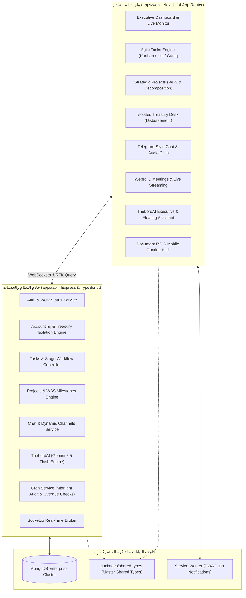
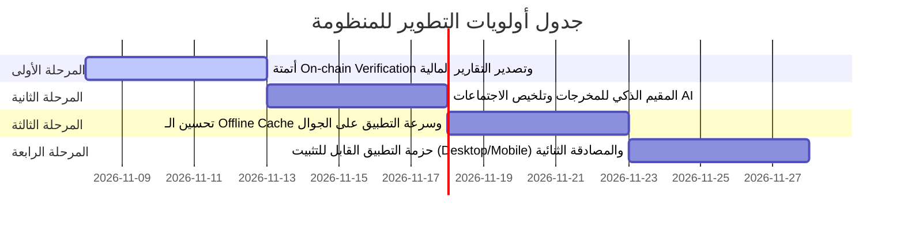

Master Codebase Audit And Future Roadmap
# وثيقة التدقيق الشامل وخطة التطوير الاستراتيجية لمنظومة THE LORD ERP.C.P AI System

> [!NOTE]
> تم إعداد هذه الوثيقة بعد قراءة ومراجعة شاملة لكافة ملفات المشروع البرمجية (Monorepo: `apps/api`، `apps/web`، `packages/shared-types`) وفحص جميع النماذج (Models)، المتحكمات (Controllers)، المسارات (Routes)، مكونات الواجهة (Components)، وخدمات الذكاء الاصطناعي وWebSockets.

---

## 1. الهيكل المعماري والوضع الراهن للمنظومة (Current Architecture State)

المنظومة مصممة وفق أحدث معايير **Enterprise Clean Architecture** وتعتمد بنية الـ Monorepo:

---

## 2. جدول جرد الموديولات البرمجية الحالية وفحص كفاءتها (Module Health Check)

| الموديول / المسار | ملفات الـ API | ملفات الـ Web | التقييم الفني | الملاحظات والجاهزية |
| :--- | :--- | :--- | :--- | :--- |
| **لوحة القيادة والمراقبة اللحظية** | `auth.controller.ts`, `users.controller.ts` | `dashboard/page.tsx` | ممتاز (9.5/10) | رصد مباشر لحالات الكادر (قيد العمل، استراحة، خروج) مع تغذية ميزانية الصندوق |
| **محرك المهام والمراحل الإلزامية** | `tasks.controller.ts`, `Task.model.ts` | `tasks/page.tsx`, `StageDeliverableBox.tsx` | ممتاز (9.8/10) | دورة اعتماد 3 مراحل، مكافآت البونتي، إسناد بالقسم، وتبويبات ذكية متجاوبة مع الجوال |
| **إدارة المشاريع الاستراتيجية (WBS)** | `projects.controller.ts`, `Project.model.ts` | `projects/page.tsx` | ممتاز (9.4/10) | تفكيك بالذكاء الاصطناعي، تحويل لمهام، تعديل، حذف، وسقف مالي حرج للمشروع |
| **الخزينة والصندوق المعزول** | `treasury.controller.ts`, `accounting.service.ts` | `payout-desk/page.tsx` | قوي جداً (9.7/10) | عزل كامل للصندوق، تدقيق السيولة، توثيق الحوالات مع سحب لقطات الإيصال |
| **التواصل والمحادثات والمكالمات** | `chat.controller.ts`, `Channel.model.ts` | `chat/page.tsx`, `AudioCallModal.tsx` | ممتاز (9.2/10) | أسلوب تيليجرام، قنوات مخصصة، مكالمات صوتية WebRTC، وموجات صوتية |
| **البث المباشر والاجتماعات** | `meeting.controller.ts`, `MeetingRoom.model.ts` | `meeting/page.tsx` | جيد جداً (8.8/10) | بث فيديو حي، إشارات WebRTC، وملاحظات الاجتماع المباشرة |
| **مركز الذكاء الاصطناعي المساعد** | `theLordAI.service.ts`, `ai.routes.ts` | `ai-hub/page.tsx`, `TheLordAIFloatingAssistant.tsx` | ممتاز (9.5/10) | مساعد عائم، تفريغ صوتي للمهام، جدار ناري مالي عازل للموظفين |
| **الأيقونة العائمة وإشعارات الـ PWA** | `cron.service.ts`, `socket.service.ts` | `TopBar.tsx`, `sw.js` | ممتاز (9.6/10) | نافذة PiP للمكتب، لوحة HUD عائمة للجوال، وتقارير منتصف الليل الآلية |

---

## 3. خطة التطوير الشاملة المستقبلية (Strategic Roadmap)

للارتقاء بالمنظومة من المستوى الحالي المتميز إلى أعلى مستويات الأنظمة العالمية الرائدة (ClickUp + Telegram + Binance المؤسسية)، تم تفصيل خطة التطوير إلى **6 ركائز ومسارات**:

---

### المسار الأول: تعزيز الأداء اللحظي والكاش المتقدم (Real-Time & Offline Optimization)
* [ ] **IndexedDB Client Caching:** إضافة كاش محلي للرسائل والمهام باستخدام IndexedDB في المتصفح لتمكين تصفح المحادثات والمهام حتى عند انقطاع الاتصال المؤقت بالإنترنت (Offline Mode).
* [ ] **Socket Reconnection State Recovery:** حفظ آخر طابع زمني للمزامنة (Last Synced Timestamp) بحيث يقوم العميل عند إعادة الاتصال بعد انقطاع بجلب الفروقات التراكمية (Delta Sync) دون استهلاك شبكة.
* [ ] **Virtual Scrolling في المحادثات والمهام الضخمة:** دعم الـ Virtualization للقوائم التي تتجاوز 1,000 عنصر لتوفير الذاكرة وسرعة استجابة فائقة على الأجهزة الضعيفة.

---

### المسار الثاني: التحليلات المالية المتقدمة والتتبع الذكي (Advanced Fintech & Treasury)
* [ ] **التكامل المباشر مع شبكة BSC (On-chain Verification):** فحص مباشر لصحة تجزئة المعاملة (`TxHash`) لشبكة BEP20 USDT عبر RPC/BscScan API والتأكد من إيداعها للمحفظة الفعلية وتطابق القيمة قبل الاعتماد النهائي.
* [ ] **لوحة التدفقات النقدية التوقعية (Cash Flow Forecast):** رسم بياني يوضح معدل الصرف الشهري، الرواتب المتوقعة، والمكافآت مقارنة برصيد الميزانية العامة لتنبيه المسؤول قبل نفاد السيولة التشغيلية بفترة كافية.
* [ ] **تصدير الكشوفات المالية الرسمية (PDF / Excel Reports):** توليد تقارير مالية بصيغة PDF ملكية بضغطة زر لكشوفات حسابات الموظفين، سجلات الصندوق، ومصروفات الإعلانات وحملات الترويج.

---

### المسار الثالث: الذكاء الاصطناعي التوليدي والتحليل التنبؤي (TheLordAI 3.0)
* [ ] **المقيم الذكي للمخرجات (AI Deliverable Quality Scorer):** تحليل ملفات الإنجاز وروابط المنشورات المرفوعة من الموظفين عبر الذكاء الاصطناعي وإعطائها تقييماً أولياً من 10 مع ملخص دقيق لنقاط القوة والضعف لمساعدة المسؤول في اتخاذ قرار الاعتماد بسرعة.
* [ ] **التوليد الآلي لخطط الحملات الإعلانية:** ميزة في TheLordAI لتوليد نصوص إعلانات تليجرام، استراتيجيات التسويق، وصيغ الرسائل الترويجية متوافقة تماماً مع القنوات المستهدفة.
* [ ] **التلخيص التلقائي للاجتماعات عبر الصوت:** عند انتهاء أي اجتماع فيديو أو مكالمة صوتية، يقوم الذكاء الاصطناعي بتوليد محضر الاجتماع (Meeting Minutes) وتوزيع المهام المنبثقة عنه تلقائياً.

---

### المسار الرابع: أتمتة دورات العمل (Automated Business Workflows)
* [ ] **المسارات التلقائية للمهام الدورية:** جدولة تفعيل المهام الصباحية اليومية التلقائية عبر Cron Job في تمام الساعة 8:30 صباحاً لكل موظف حسب تخصصه وقسمه.
* [ ] **سلالم التصعيد الآلية (Escalation Triggers):** إذا تأخر موظف عن تسليم مرحلة حرجة تتجاوز مدتها المحددة، يُرسل تنبيه تصعيدي تدريجي للموظف ثم لرئيس القسم ثم للمدير العام.
* [ ] **محرك المكافآت التلقائي (Auto-Incentive Payout Trigger):** فور اعتماد مهمة البونتي من الإدارة، إدراج أمر الصرف فوراً في الصندوق دون الحاجة لإدخال يدوي.

---

### المسار الخامس: تجربة الهاتف والـ Native PWA App
* [ ] **حزمة تطبيق سطح المكتب والجوال (Tauri / Capacitor Wrapper):** تحويل المنظومة إلى تطبيق قابل للتثبيت كبرنامج مكتبي (Windows .exe) وتطبيق موبايل (Android APK) بنقرة واحدة مع احتفاظ كامل بنفس واجهة وميزات الويب الحالية.
* [ ] **حركات السحب والتفاعل اللمسي (Touch Gestures):** دعم السحب لليمين واليسار (Swipe to Action) لنقل المهام في الكانبان أو الرد السريع على الرسائل.
* [ ] **نغمة إشعارات خاصة قابلة للتخصيص:** إتاحة اختيار نغمات تنبيهية متعددة من إعدادات الملف الشخصي للمستخدم.

---

### المسار السادس: الحماية العالية والنسخ الاحتياطي (Enterprise Security & Backup)
* [ ] **النسخ الاحتياطي الآلي اليومي (Automated Mongo Dump):** أتمتة تصدير نسخة احتياطية مشفرة من قاعدة البيانات وتخزينها سحابياً في موقع منفصل يومياً الساعة 03:00 فجراً.
* [ ] **سجل النشاطات والأمان الحرج (Audit Log Trail):** توثيق كل عملية حذف، تعديل مالي، تغيير كلمة مرور، أو صلاحية بعنوان الـ IP ونوع الجهاز لحماية الخزينة والبيانات.
* [ ] **المصادقة الثنائية (2FA / TOTP):** تفعيل تطبيق المصادقة (Google Authenticator) لعمليات الصرف المالي والإدارة العليا.

---

## 4. خطة التنفيذ المرحلية المقترحة (Execution Phases)

---
*تم إعداد هذا التقرير والخطة البرمجية بواسطة مهندس الذكاء الاصطناعي التنفيذي لمنظومة TheLord ERP.*
