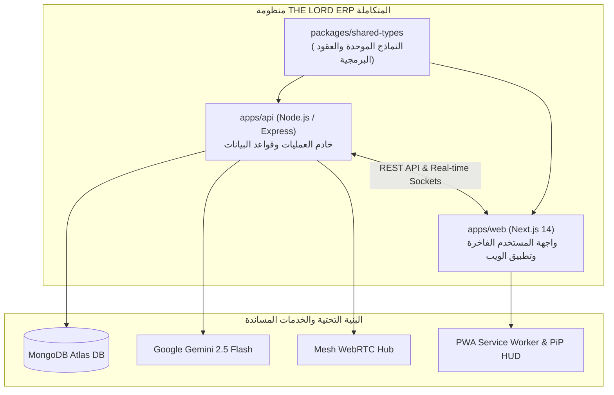
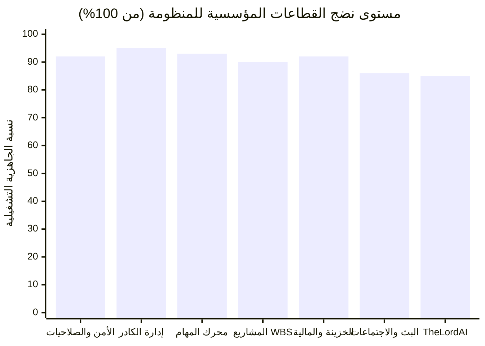
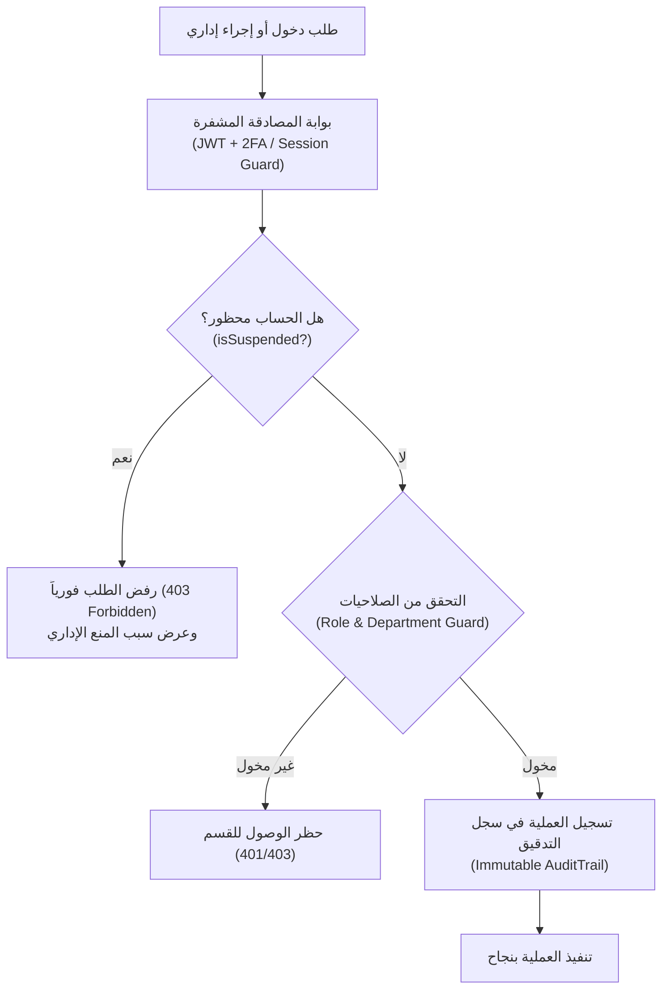
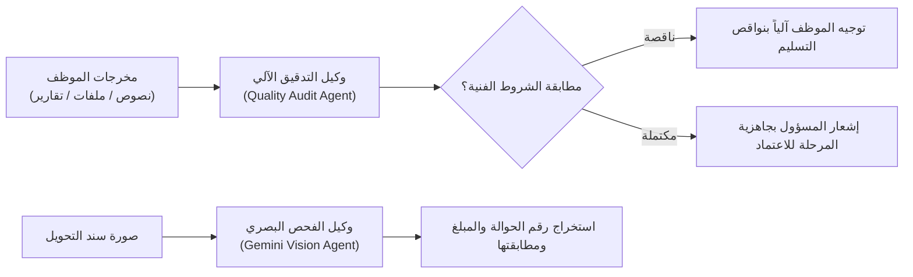
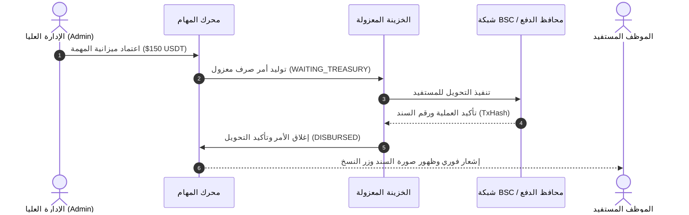
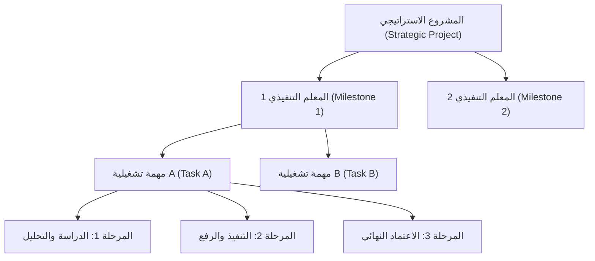
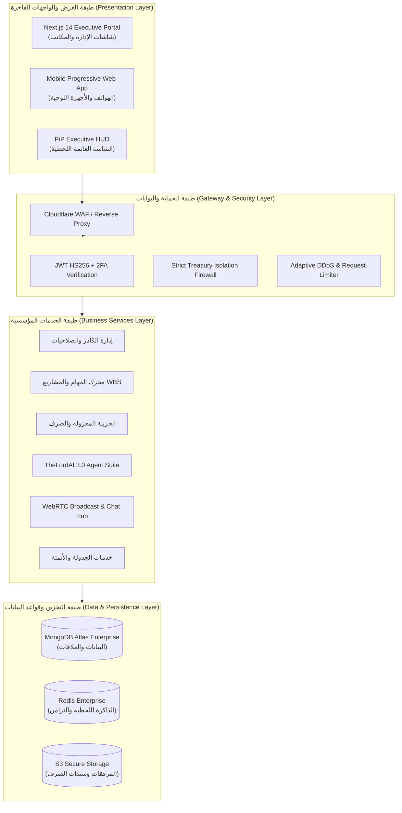
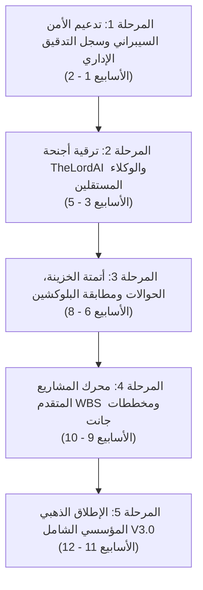

# 🏛️ THE LORD ERP — Master Enterprise Development Plan
## الخطة الاستراتيجية الشاملة لتطوير وتوسيع منظومة إدارة العمليات والموارد المؤسسية (ERP • AI • Corporate Operations)

> **الإصدار:** 3.0 Corporate Enterprise Edition  
> **التاريخ:** 7 نوفمبر 2026  
> **المستوى الأمني:** وثيقة استراتيجية عليا — للإدارة العليا فقط (Strictly Confidential - Executive Eyes Only)  
> **البيئة التقنية:** Next.js 14 (App Router) • Node.js / Express • MongoDB Atlas • Socket.io • WebRTC • Gemini 2.5/3.0 AI Flash

---

## 📑 فهرس المحتويات التنفيذي
1. [الرؤية والهدف الاستراتيجي للمنظومة المؤسسية](#1-الرؤية-والهدف-الاستراتيجي-للمنظومة-المؤسسية)
2. [ملخص التدقيق الشامل لكافة ملفات الكود الراهنة](#2-ملخص-التدقيق-الشامل-لكافة-ملفات-الكود-الراهنة)
3. [مصفوفة النضج الرقمي وتقييم الأداء البرمجي](#3-مصفوفة-النضج-الرقمي-وتقييم-الأداء-البرمجي)
4. [الركائز الخمس لتطوير المنظومة المؤسسية (The 5 Strategic Pillars)](#4-الركائز-الخمس-لتطوير-المنظومة-المؤسسية-the-5-strategic-pillars)
   - [المسار الأول: الأمن السيبراني، إدارة الصلاحيات والعزل المؤسسي (Zero-Trust Security & Enterprise RBAC)](#المسار-الأول-الأمن-السيبراني-إدارة-الصلاحيات-والعزل-المؤسسي)
   - [المسار الثاني: أجنحة TheLordAI، الوكلاء المستقلون ومحرك المعرفة المؤسسية (Autonomous AI Agents & Enterprise RAG)](#المسار-الثاني-أجنحة-thelordai-الوكلاء-المستقلون-ومحرك-المعرفة-المؤسسية)
   - [المسار الثالث: الخزينة المعزولة، الحوالات والربط المالي الشامل (Isolated Treasury & Multi-Wallet Financial Management)](#المسار-الثالث-الخزينة-المعزولة-الحوالات-والربط-المالي-الشامل)
   - [المسار الرابع: محرك المهام الرشيقة، المشاريع الاستراتيجية WBS ومصفوفة الإنتاجية (Agile Execution, WBS & KPI Engine)](#المسار-الرابع-محرك-المهام-الرشيقة-المشاريع-الاستراتيجية-wbs-ومصفوفة-الإنتاجية)
   - [المسار الخامس: تجربة المستخدم الفاخرة، البث المرئي المؤسسي وتطبيق الويب التقدمي (Luxury Enterprise UX, WebRTC & PWA)](#المسار-الخامس-تجربة-المستخدم-الفاخرة-البث-المرئي-المؤسسي-وتطبيق-الويب-التقدمي)
5. [مخطط المعمارية المؤسسية المستهدفة (Target Corporate Architecture)](#5-مخطط-المعمارية-المؤسسية-المستهدفة-target-corporate-architecture)
6. [جدول المراحل الزمنية ومؤشرات الإنجاز (Phased Implementation Roadmap & KPIs)](#6-جدول-المراحل-الزمنية-ومؤشرات-الإنجاز-phased-implementation-roadmap--kpis)
7. [مصفوفة إدارة المخاطر واستمرارية العمليات (Risk Matrix & Business Continuity)](#7-مصفوفة-إدارة-المخاطر-واستمرارية-العمليات-risk-matrix--business-continuity)

---

## 1. الرؤية والهدف الاستراتيجي للمنظومة المؤسسية

تحويل منظومة **THE LORD ERP** إلى منصة عمليات مؤسسية ذكية فخمة متكاملة تُدار بأعلى معايير الإدارة الرقمية العالمية:
- **تحكم إداري مركزي صارم:** تمكين القيادة العليا من الإشراف اللحظي الكامل على كافة الأقسام، الكوادر الوظيفية، الصلاحيات، والمهام دون انقطاع.
- **أتمتة ذكية مدعومة بالذكاء الاصطناعي:** دمج وكلاء ذكاء اصطناعي مستقلين (Autonomous AI Agents) لمراجعة جودة التسليمات، إدارة المحتوى، وتوليد التقارير اليومية تلقائياً.
- **إدارة مالية معزولة وآمنة:** عزل كامل لعمليات الخزينة والصرف المالي، والربط الدقيق مع شبكة BSC (USDT) والمحافظ المحلية (جيب وجوالي) مع إثبات التحويلات وسندات الصرف.
- **إنتاجية عالية وتنسيق لحظي:** بيئة عمل تعاونية فورية تجمع الدردشة المؤسسية، غرف البث المرئي المباشر، ومحرك المهام والمشاريع المتقدم (WBS).

---

## 2. ملخص التدقيق الشامل لكافة ملفات الكود الراهنة

تم إجراء فحص شامل لكافة ملفات ومجلدات المنظومة:



### حالة الجاهزية والتقييم الفعلي للمكونات:

| الوحدة / المجلد | المسار في المشروع | نسبة الجاهزية | أبرز الإنجازات المحققة | المستهدفات التطويرية القادمة |
| :--- | :--- | :---: | :--- | :--- |
| **المصادقة والأمن** | [`auth.controller.ts`](file:///e:/webProject/TheLord%20ERP.C.P%20AI%20system/apps/api/src/controllers/auth.controller.ts) | 92% | تسجيل الدخول المشفر، المنع الإداري الفوري للحسابات المحظورة | إضافة التحقق الثنائي (2FA) عبر تليجرام وتوثيق الأجهزة |
| **إدارة الكادر والمستخدمين** | [`users.controller.ts`](file:///e:/webProject/TheLord%20ERP.C.P%20AI%20system/apps/api/src/controllers/users.controller.ts) | 95% | تعديل كلمات السر، الحظر اللحظي، الحذف الآمن، كشوفات المستحقات | سجل التدقيق الإداري الشامل غير القابل للتعديل (`AuditLogs`) |
| **محرك المهام والمراحل** | [`tasks.controller.ts`](file:///e:/webProject/TheLord%20ERP.C.P%20AI%20system/apps/api/src/controllers/tasks.controller.ts) | 93% | مراحل تسلسلية، اعتماد الميزانيات، التسجيل الصوتي، أكورديون المراحل | تدقيق مخرجات المهام آلياً بواسطة وكيل الذكاء الاصطناعي |
| **المشاريع الاستراتيجية (WBS)** | [`projects.controller.ts`](file:///e:/webProject/TheLord%20ERP.C.P%20AI%20system/apps/api/src/controllers/projects.controller.ts) | 90% | هيكل تقسيم العمل (WBS)، تتبع المعالم، ربط المهام بالمشاريع | مخطط جانت التفاعلي التلقائي ومخططات الإنجاز التراكمي |
| **الخزينة المعزولة والصرف** | [`treasury.controller.ts`](file:///e:/webProject/TheLord%20ERP.C.P%20AI%20system/apps/api/src/controllers/treasury.controller.ts) | 92% | العزل المالي التام، أوامر الصرف، إثبات الحوالات وسندات التحويل | المطابقة الآلية لمعاملات شبكة BSC عبر RPC وتوليد الكشوفات |
| **الدردشة والاتصال** | [`chat.controller.ts`](file:///e:/webProject/TheLord%20ERP.C.P%20AI%20system/apps/api/src/controllers/chat.controller.ts) | 88% | القنوات الرسمية، الرسائل المباشرة، المرفقات، قنوات الخزينة | تشفير المحادثات والبحث المتقدم في الرسائل والمستندات |
| **غرف البث والاجتماعات** | [`meeting.controller.ts`](file:///e:/webProject/TheLord%20ERP.C.P%20AI%20system/apps/api/src/controllers/meeting.controller.ts) | 86% | وضع الاستعداد اليدوي الآمن، WebRTC، مشاركة الشاشة والشات الحي | تسجيل الاجتماعات سحابياً وتلخيص النقاشات تلقائياً بـ AI |
| **أجنحة TheLordAI** | [`theLordAI.service.ts`](file:///e:/webProject/TheLord%20ERP.C.P%20AI%20system/apps/api/src/services/theLordAI.service.ts) | 85% | المساعد العائم، الجدار الناري المالي، تفريغ الصوت وتحويله لمهام | تفعيل محرك RAG المؤسسي واستيعاب كافة سياسات العمل |
| **الواجهة الأمامية الفاخرة** | `apps/web/src` | 94% | ثيم Obsidian & Imperial Gold الفاخر، توافق تام مع اللابتوب والموبايل | تصدير التقارير الرسمية وإدارة الإشعارات في الخلفية |

---

## 3. مصفوفة النضج الرقمي وتقييم الأداء البرمجي



---

## 4. الركائز الخمس لتطوير المنظومة المؤسسية (The 5 Strategic Pillars)

### المسار الأول: الأمن السيبراني، إدارة الصلاحيات والعزل المؤسسي
#### (Zero-Trust Security & Enterprise RBAC)



1. **التحقق الثنائي للمسؤولين (Executive 2FA):**
   - إضافة خيار التحقق الثنائي عبر تطبيقات المصادقة (Google Authenticator / TOTP) أو إرسال رمز تحقق مشفر عبر بوت تليجرام الإداري عند تسجيل الدخول من جهاز جديد.
2. **سجل التدقيق الإداري الشامل غير القابل للتعديل (Immutable Audit Log):**
   - إنشاء سجل تاريخي دقيق (`AuditTrail`) يوثق كافة العمليات الحساسة:
     - تعديل كلمات المرور أو حظر الحسابات.
     - تعديل ميزانيات المهام أو أوامر الصرف المالي.
     - تعديل رواتب الكادر أو منح المكافآت والخصومات والإنذارات.
     - توثيق عنوان IP، الجهاز، واسم المستخدم ووقت التنفيذ بالمللي ثانية.
3. **الجدار الناري للأذونات الفرعية (Granular Permission Scopes):**
   - إتاحة تخصيص صلاحيات محددة لقادة الفرق (Team Leads) مثل: اعتماد مراحل محددة، الاطلاع على تقارير قسمهم فقط، دون السماح بالاطلاع على بقية الأقسام أو المالية.

---

### المسار الثاني: أجنحة TheLordAI، الوكلاء المستقلون ومحرك المعرفة المؤسسية
#### (Autonomous AI Agents & Enterprise RAG)



1. **محرك المعرفة المؤسسية وقاعدة البيانات الدلالية (Enterprise RAG Engine):**
   - فهرسة وثائق المنظومة، الهياكل الإدارية، وسياسات العمل المعتمدة باستخدام Vector Embeddings وقاعدة بيانات المعرفة.
   - تمكين TheLordAI من تقديم إرشادات واستشارات دقيقة ومخصصة لكل موظف وفق اختصاصه وقواعد العمل المؤسسي.
2. **وكيل التدقيق الآلي لجودة التسليمات (Quality Audit Agent):**
   - فحص مخرجات المراحل المرفوعة من الموظفين والتأكد من استيفاء كافة الحقول المطلوبة (الملفات، التقارير، الروابط) قبل إرسالها للمسؤول، مما يقلل وقت المراجعة الإدارية بنسبة تفوق 70%.
3. **وكيل التدقيق البصري لسندات الصرف (Vision Receipt Auditor):**
   - فحص صور السندات والحوالات المرفوعة من الخزينة بواسطة الذكاء البصري (Gemini Vision) لمطابقة المبالغ وأرقام العمليات تلقائياً.
4. **وكيل صياغة المحتوى والتسويق المؤسسي (Corporate Content Agent):**
   - توليد وصياغة المنشورات والرسائل الإعلانية الرسمية بأسلوب بشري احترافي فخم وجذاب، مع التدقيق اللغوي الآلي.

---

### المسار الثالث: الخزينة المعزولة، الحوالات والربط المالي الشامل
#### (Isolated Treasury & Multi-Wallet Financial Management)



1. **المطابقة الآلية مع شبكة BSC (Automated BSC RPC Verification):**
   - فحص تلقائي لهاش المعاملات (TxHash) عبر عقد Binance Smart Chain الرسمي للتحقق من وصول المبلغ للعنوان المحدد وتاريخ التنفيذ.
2. **نظام الخزائن والصناديق المتعددة (Multi-Vault Architecture):**
   - تقسيم الميزانية العامة للشركة إلى صناديق مستقلة:
     - **صندوق الرواتب والمكافآت:** معزول تماماً ومخصص للكوادر.
     - **صندوق الحملات والتسويق:** لتغطية ميزانيات الإعلانات والحملات المعتمدة.
     - **صندوق الطوارئ والتطوير التقني:** للاشتراكات والخدمات السحابية.
3. **أتمتة الكشوفات والتقارير المالية (Automated Financial Reporting):**
   - تصدير كشوفات الحسابات والرواتب الرسمية المعتمدة (PDF / Excel) بضغطة زر واحدة، متضمنة الأرقام المرجعية، أسماء المستفيدين، وتاريخ ووقت الصرف.

---

### المسار الرابع: محرك المهام الرشيقة، المشاريع الاستراتيجية WBS ومصفوفة الإنتاجية
#### (Agile Execution, WBS & KPI Engine)



1. **مخططات جانت التفاعلية ومسارات المشاريع (Interactive Gantt & Critical Path):**
   - عرض زمني مرئي للمشاريع والمعالم التنفيذية (Milestones)، يوضح العلاقات التتابعية والتبعيات بين المهام.
2. **محرك تقييم الأداء الثلاثي التلقائي (Automated 3-Factor KPI Engine):**
   - احتساب دقيق لجدارة وترتيب الموظفين في لوحة الشرف بناءً على:
     $$\text{Total Score} = (C \times 40\%) + (S \times 30\%) + (Q \times 30\%)$$
     - **معدل الإنجاز ($C$):** نسبة المهام المنجزة بنجاح مقارنة بالمهام المسندة.
     - **سرعة التسليم ($S$):** الالتزام بالمواعيد المحددة والتسليم قبل انتهاء الوقت.
     - **جودة التنفيذ ($Q$):** قبول المخرجات واعتماد المراحل من المحاولة الأولى دون طلب تعديل.
3. **أتمتة المهام الدورية والروتينية (Smart Recurring Task Automation):**
   - جدولة مهام الفحص اليومي والتقارير الدورية لإنشائها تلقائياً في مواعيد محددة مسبقاً وتكليف الموظفين المناسبين بها.

---

### المسار الخامس: تجربة المستخدم الفاخرة، البث المرئي المؤسسي وتطبيق الويب التقدمي
#### (Luxury Enterprise UX, WebRTC & PWA)

1. **غرف الاجتماعات والبث المرئي الفورية (Enterprise Video Broadcast Hub):**
   - تسجيل سحابي للاجتماعات مع تشفير الملفات.
   - تفريغ صوتي فوري لكلمات المتحدثين وتوليد ملخص تنفيذي ذكي بنهاية الجلسة يُوزع كمهام عمل مباشرة.
2. **لوحة المراقبة العائمة الذكية (Picture-in-Picture Executive HUD):**
   - شاشة عائمة مصغرة ترافق المسؤول أو الموظف خارج المتصفح لمتابعة العمل والإشعارات دون تشتت.
3. **تطبيق الويب التقدمي المتكامل (PWA & Offline Capability):**
   - إشعارات دفع لحظية في الخلفية (Push Notifications) عبر الهاتف المحمول حتى في حال إغلاق المتصفح.
   - كاش ذكي يتيح تصفح المهام والبيانات الأساسية دون اتصال مؤقت بالإنترنت.

---

## 5. مخطط المعمارية المؤسسية المستهدفة (Target Corporate Architecture)



---

## 6. جدول المراحل الزمنية ومؤشرات الإنجاز (Phased Implementation Roadmap & KPIs)



### التفصيل التنفيذي للمراحل:

```carousel
### 🛡️ المرحلة الأولى: الأمن السيبراني وسجل التدقيق الإداري (الأسابيع 1 - 2)
- **المخرجات الرئيسية:**
  - بناء جدول `AuditTrails` غير القابل للتلاعب لتوثيق كافة العمليات الإدارية الحساسة.
  - تفعيل التحقق الثنائي (2FA) للأدوار الإدارية عبر تليجرام وتطبيقات المصادقة.
  - تعزيز حماية الجلسات والتحقق التلقائي الصارم من الحسابات المحظورة في كل طلب ومحادثة.
- **مؤشر النجاح (KPI):** تغطية أمنية بنسبة 100% لكافة العمليات الحساسة وسرعة استجابة للمنع الإداري أقل من 100ms.
<!-- slide -->
### 🤖 المرحلة الثانية: ترقية أجنحة TheLordAI والوكلاء المستقلين (الأسابيع 3 - 5)
- **المخرجات الرئيسية:**
  - تدشين محرك المعرفة المؤسسية (Enterprise RAG) وفهرسة لوائح وسياسات العمل.
  - تفعيل وكيل التدقيق الآلي لجودة مخرجات المهام قبل رفعها للمسؤول.
  - تفعيل وكيل الفحص البصري لسندات الحوالات المالية بواسطة Gemini Vision.
- **مؤشر النجاح (KPI):** توفير 70% من وقت المراجعة الإدارية الروتينية على القيادة.
<!-- slide -->
### 🪙 المرحلة الثالثة: أتمتة الخزينة، الحوالات ومطابقة البلوكشين (الأسابيع 6 - 8)
- **المخرجات الرئيسية:**
  - التحقق التلقائي من هاش معاملات شبكة BSC عبر RPC ومطابقة المبالغ والعناوين.
  - تدشين نظام الصناديق المتعددة (الرواتب، التسويق، الصيانة والاشتراكات).
  - تصدير كشوفات الحسابات والرواتب الرسمية المعتمدة (PDF/Excel) بضغطة زر.
- **مؤشر النجاح (KPI):** مطابقة مالية بنسبة 100% بين السجلات الدفترية والأرصدة الفعلية في المحافظ.
<!-- slide -->
### 📊 المرحلة الرابعة: محرك المشاريع المتقدم WBS ومخططات جانت (الأسابيع 9 - 10)
- **المخرجات الرئيسية:**
  - بناء عرض مخطط جانت التفاعلي لمسارات المشاريع الاستراتيجية والمعالم (Milestones).
  - أتمتة توليد المهام المرتبطة بالأحداث والمهام الروتينية اليومية.
  - تحسين مصفوفة التقييم التلقائي للأداء (KPIs) في لوحة الشرف.
- **مؤشر النجاح (KPI):** وضوح مسار تقدم المشاريع بنسبة 100% ودقة احتساب مؤشرات الأداء اللحظية.
<!-- slide -->
### 🚀 المرحلة الخامسة: الإطلاق الذهبي المؤسسي الشامل V3.0 (الأسابيع 11 - 12)
- **المخرجات الرئيسية:**
  - اختبارات الضغط الشاملة ومحاكاة 500+ مستخدم متزامن على خوادم الـ Sockets والـ WebRTC.
  - التدقيق النهائي لتطبيق الهاتف المحمول (PWA) والإشعارات في الخلفية.
  - إطلاق النسخة الرسمية المتكاملة لجميع كوادر المؤسسة.
- **مؤشر النجاح (KPI):** سرعة استجابة أقل من 150ms وثبات تشغيلي للمنظومة بنسبة 99.99%.
```

---

## 7. مصفوفة إدارة المخاطر واستمرارية العمليات (Risk Matrix & Business Continuity)

| الخطر المحتمل | مستوى الأثر | الاحتمالية | خطة الاحتواء والاستجابة الفورية |
| :--- | :---: | :---: | :--- |
| **تسريب بيانات الرواتب أو الميزانيات** | مرتفع جداً | منخفضة جداً | استمرار العزل التام لقسم الخزينة (`treasuryIsolationGuard`) وتشفير البيانات المالية وقفل الوصول بـ RBAC. |
| **تجاوز حصة خدمات الذكاء الاصطناعي (Quota Limits)** | متوسط | متوسطة | استخدام نظام التوجيه التلقائي متعدد المزودين (Multi-AI Provider Router) للتحويل الفوري إلى نموذج بديل دون انقطاع. |
| **انقطاع اتصال خوادم الـ WebRTC أثناء البث** | متوسط | منخفضة | إعادة الاتصال التلقائي (Exponential Backoff Auto-Reconnect) والاحتفاظ ببيانات الغرفة واستعادة البث في أجزاء من الثانية. |
| **محاولة وصول غير مصرح بها بحساب محظور** | مرتفع | منخفضة | فحص حالة الحظر `isSuspended` عند كل طلب REST وفي مصادقة WebSocket وقطع الجلسة فورياً. |
| **فقدان أو تلف قاعدة البيانات** | مرتفع جداً | منخفضة جداً | تفعيل النسخ الاحتياطي التلقائي السحابي لـ MongoDB Atlas كل 6 ساعات مع إمكانية الاستعادة في أي نقطة زمنية (PITR). |

---

> [!TIP]
> **التوصية التنفيذية للمسار القادم:** الخطوة الأكثر فاعلية للبدء المباشر هي **المرحلة الأولى (التدعيم الأمني الشامل، 2FA وسجل التدقيق الإداري)** متبوعة بـ **المرحلة الثانية (وكلاء الذكاء الاصطناعي المستقلين لتدقيق المهام ومراجعة السندات)** لرفع الكفاءة التشغيلية للمنظومة إلى أعلى المستويات.
